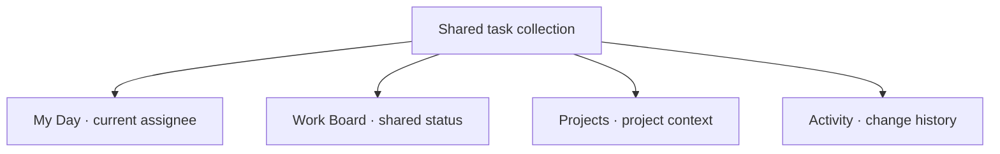
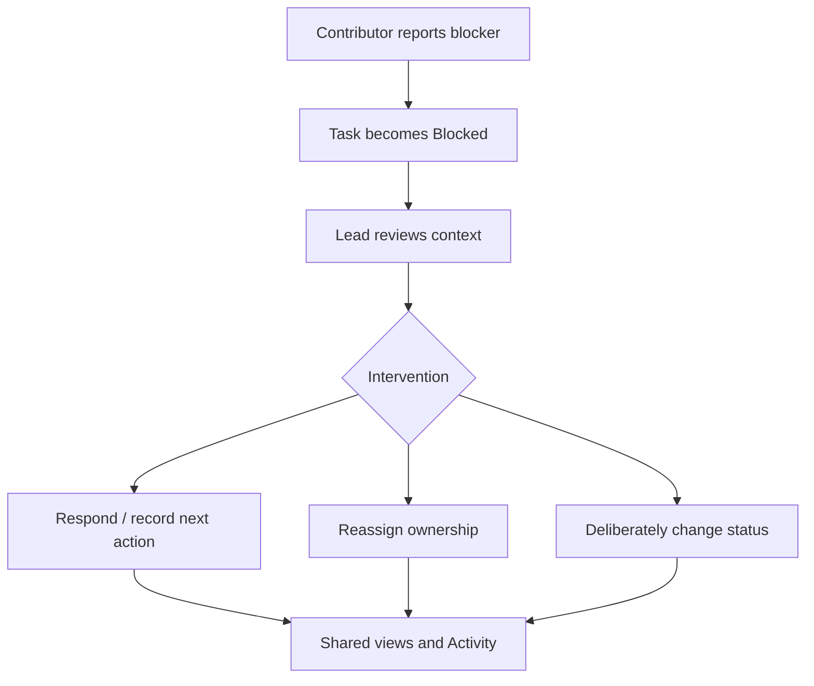
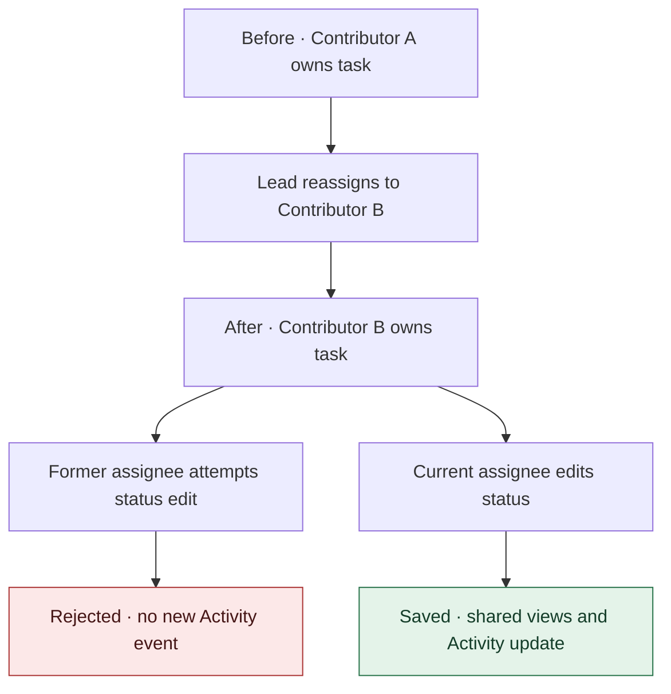
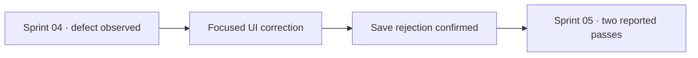

# WorkAtlas — Visual evidence atlas

Independent portfolio prototype · Synthetic scenarios · Manual results, not production validation

## 01 / One task, four perspectives

Design intent: a reassignment changes ownership, not project association or status by itself. Activity represents the actor separately from the assignee. This is conceptual information architecture, not a verified backend schema.

## 02 / From blocker to intervention

Sprint 03: five user-reported manual workflow checks passed. The branches illustrate possible actions, not a required sequence or exhaustive test coverage.

## 03 / Ownership changes; history stays

Sprint 04 exposed a former-assignee status-edit defect. A focused correction restricted editing and saving. Sprint 05 recorded user-reported passes for the two illustrated regression paths, including the checked refresh scenarios. Contributor A/B are illustrative labels, not research participants.

## 04 / Evidence, not impact

| Sprint | Recorded manual checks | Initial result |
| --- | ---: | --- |
| 02 | 3 | 3 passed |
| 03 | 5 | 5 passed |
| 04 | 5 | 4 passed, 1 failed |
| 05 | 2 | 2 passed |

Counts describe recorded checks, not participants, success rates, adoption or business impact. The Sprint 04 follow-up is intentionally not added to the counts. No new testing was performed for this visual atlas.

**Still unverified:** production authorization, concurrency, cross-device persistence, exhaustive role coverage, formal usability and business impact.

Source: [README](../README.md) and [Sprint 03–05 verification log](SPRINT_03_BLOCKER_RESOLUTION.md). All diagrams are explanatory design artifacts derived from those records.
